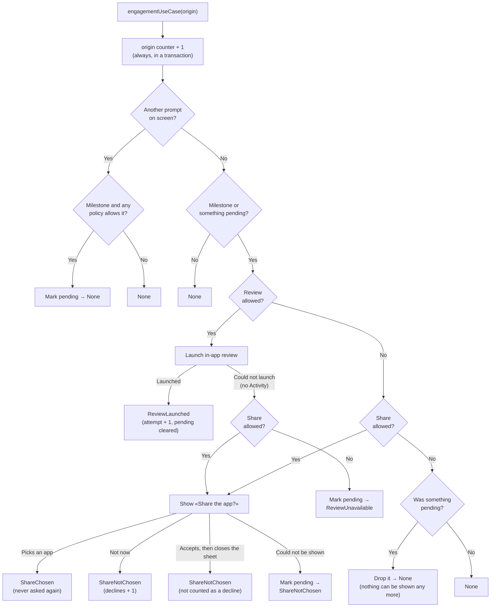
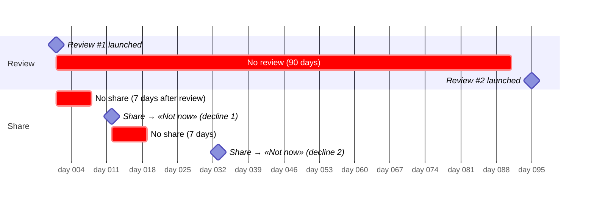
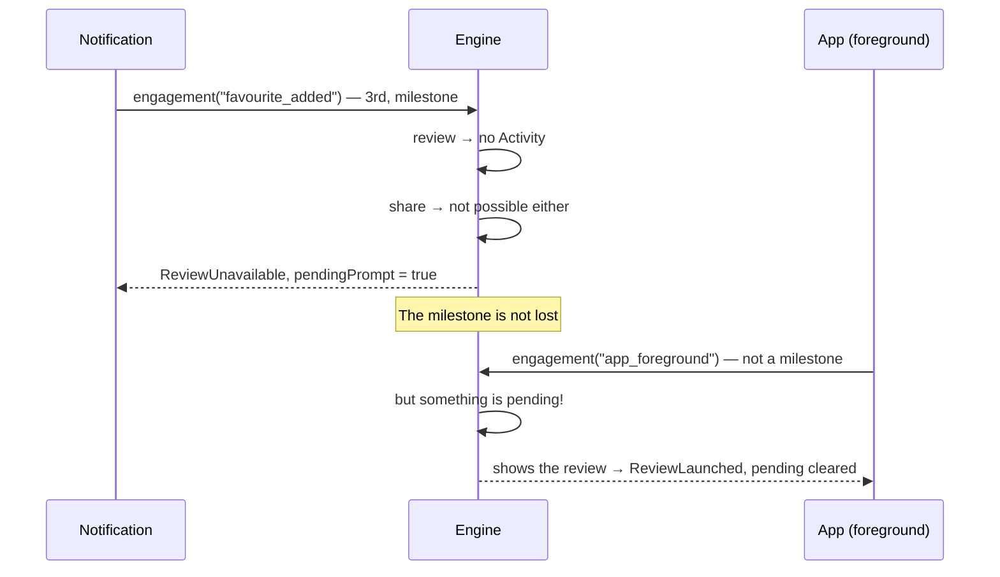
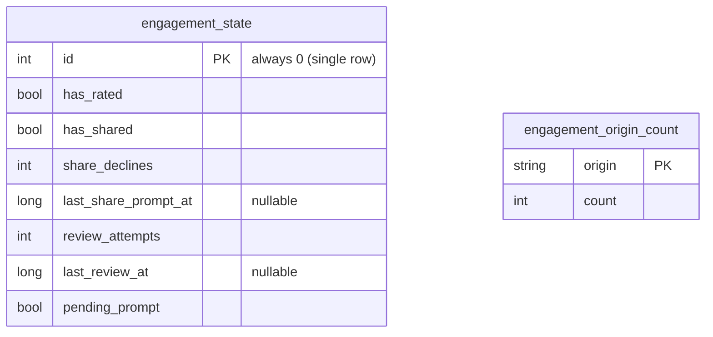
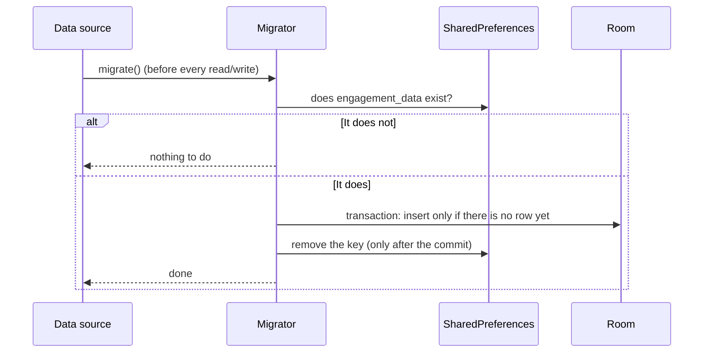

# platform-engagement

Asks the user to **rate the app** (Google Play in-app review) or **share it** at the right moment, without nagging.

The app only tells the engine that "something good just happened". The engine decides whether to ask, what to ask for and when to ask again.

```kotlin
engagementUseCase(EngagementUseCase.Params(origin = "favourite_added"))
```

---

## 1. The idea in 30 seconds

| Concept | What it is | Example |
|---|---|---|
| **Origin** (`origin`) | Name of the moment that triggers the call. Each origin has its own counter. | `"favourite_added"`, `"long_listening_session"` |
| **Milestone** (`EngagementEligibility`) | Rule that says on which occurrence of an origin it is worth asking. Defined by the app. | 3rd time, then every 10th |
| **Policy** (`PromptPolicy`) | Global limits so the user is not bothered: how many times and how often the review or the share prompt can be shown. | Review: at most 3 times, 90 days apart |
| **Pending** (`pendingPrompt`) | A milestone that was reached but could not be shown. It is not lost: it is shown on the next call. | Favourite added from the notification while the app is closed |

In one sentence: **every call adds 1 to its origin's counter. If it is a milestone (or something is pending) and the policy allows it, the review is shown or, if that is not possible, the share prompt.**

---

## 2. What happens on each call



Priority: **review first, then share**. Only one thing is shown per call.

---

## 3. The rules that prevent nagging

| | Review (in-app review) | Share («Share the app?») |
|---|---|---|
| Never again once… | The user rated from Settings (`MarkAppAsRatedUseCase`) | The user picked an app to share with |
| Maximum | 3 launches | 3 «Not now» answers |
| Wait between two | 90 days | 7 days |
| Gap with the other one | 7 days since the last share prompt | 7 days since the last review |

The last row means **the user is asked at most once a week**, whatever the prompt.

Why is the review not "once and done"? Google Play **does not report whether the dialog was actually shown**: it has its own quota and may silently ignore the request. That is why it is retried at most 3 times, 90 days apart.

---

## 4. Practical cases

The examples use the default rule (`DefaultEngagementEligibility`): milestone on the **3rd** occurrence and then on the **10th, 20th, 30th…**

### Case 1: the happy path

Ana adds stations to her favourites.

| Favourite # | Milestone? | What Ana sees |
|---|---|---|
| 1, 2 | No | Nothing |
| 3 | **Yes** | Google Play rating dialog → `ReviewLaunched` |
| 4 … 9 | No | Nothing |
| 10 | **Yes** | Nothing: the review was less than 7 days ago, and the next review is not due for 90 days |
| 20 (days later) | **Yes** | «Share the app?» |

### Case 2: the timeline of a loyal user



- Day 1: milestone → review #1.
- Day 12: milestone → the review is cooling down, so the share prompt is shown. «Not now».
- Day 33: milestone → share prompt again. «Not now» (2 declines; after the 3rd it is never asked again).
- Day 95: milestone → 90 days have passed → review #2.
- After review #3 the review is never requested again.

### Case 3: the milestone is reached while the app is not open (pending)

Ana marks a station as favourite **from the player notification**, with the app in the background. It is her 3rd favourite, but there is no screen to show the review on.



The app only needs to call the engine with some origin when it returns to the foreground (RadioSquare uses `"app_foreground"`, which is never a milestone on its own).

### Case 4: two moments at once

While the review dialog is open, another milestone fires (for example, a long listening session ends). The second one **is counted**, but it does not open another dialog on top: it is marked as pending and offered later, if the policies allow it.

### Case 5: the user rates from Settings

In Account → «Rate the app», the app opens the Play Store and calls:

```kotlin
markAppAsRatedUseCase(MarkAppAsRatedUseCase.Params)
```

From then on the review is **never** requested from that user again (the share prompt can still be shown).

### Case 6: the review could not launch and you want to offer the Play Store

```kotlin
engagementUseCase(EngagementUseCase.Params("alarm_dismissed")).onSuccess { result ->
    if (result == EngagementResult.ReviewUnavailable) {
        context.startActivity(intentFactory.build(IntentType.PlayStore))
        markAppAsRatedUseCase(MarkAppAsRatedUseCase.Params)
    }
}
```

This is optional: if you do nothing, the engine already keeps the prompt pending when appropriate.

---

## 5. Possible results

| `EngagementResult` | Meaning |
|---|---|
| `None` | Nothing was shown (not a milestone, the policies do not allow it, or another prompt was open). |
| `ReviewLaunched` | The Google Play review was launched (it does not guarantee it was seen). |
| `ReviewUnavailable` | The review could not launch and nothing was shared. |
| `ShareChosen` | The user shared the app. |
| `ShareNotChosen` | The user declined or closed the share prompt, or it could not be shown. |

---

## 6. Where progress is stored

In the module's own Room database, **`platform_engagement.db`**. The app does not need to configure anything.



- Every change (incrementing a counter, recording a review…) runs **in a transaction**: read, modify and save in one step, so two simultaneous calls never overwrite each other.
- `ObserveEngagementDataUseCase` emits the data whenever either table changes (useful, for example, for a «Rate the app» card on the home screen).

### Users coming from an older version

Progress used to be stored as JSON in the `platform_engagement` SharedPreferences. It is copied over automatically on first access:



- If the app dies between the two steps, the next run sees that Room already has data and only removes the key: **nothing is ever duplicated or lost**.
- Very old data, where `hasRated = true` meant "the review was launched once", is converted to `reviewAttempts = 1`, `hasRated = false`.

> **Backup:** to keep progress when the user switches phones, the app must include `platform_engagement.db` in its Auto Backup rules (`data_extraction_rules.xml` and `backup_rules.xml`).

---

## 7. Integrating it into an app

**1. Load the libraries** (`DeviceDILibrary` provides `InAppReview` and `InAppShare`):

```kotlin
override fun provideLibs(): List<DILibrary> = listOf(
    DeviceDILibrary(),
    EngagementDILibrary(),
)
```

**2. Attach the Activities** (in `ActivityLifecycleCallbacks.onActivityCreated`):

```kotlin
inAppReview.attach(activity)
inAppShare.attach(activity) // before the Activity is STARTED
```

**3. (Optional) Define your own milestones and share copy:**

```kotlin
class MyEligibility : EngagementEligibility {
    override fun isEligible(origin: String, count: Int): Boolean = when (origin) {
        "favourite_added" -> count == 3 || (count > 3 && count % 10 == 0)
        "long_listening_session" -> count == 1 || count == 3 || (count > 3 && count % 5 == 0)
        else -> false
    }
}

module {
    factory<EngagementEligibility> { MyEligibility() }
    factory<ShareContentProvider> { MyShareContentProvider() }
}
```

Without them the defaults apply: a milestone on the 3rd occurrence and every 10th, and a share message with the app name and its Play Store link (strings `engagement_share_subject` / `engagement_share_text`, overridable by resource name).

**4. Call the engine at positive moments**, with a different origin for each one.

### Tips

- Call the engine **after** something the user enjoyed (finishing a listening session, dismissing an alarm that worked), not when the app opens.
- Also call it when returning to the foreground with an origin that is never a milestone, so pending prompts get shown.
- Call `MarkAppAsRatedUseCase` whenever you open the Play Store page to rate.
