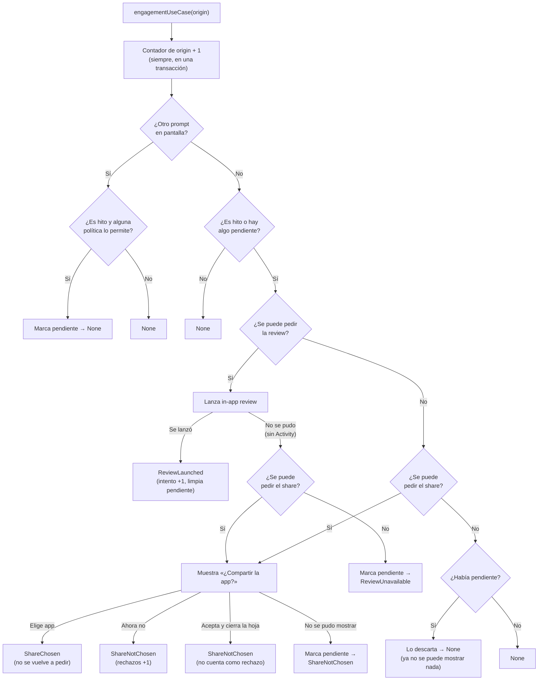
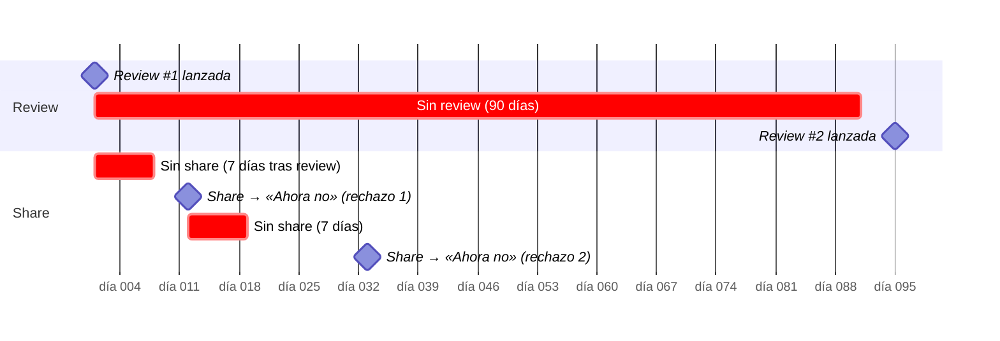
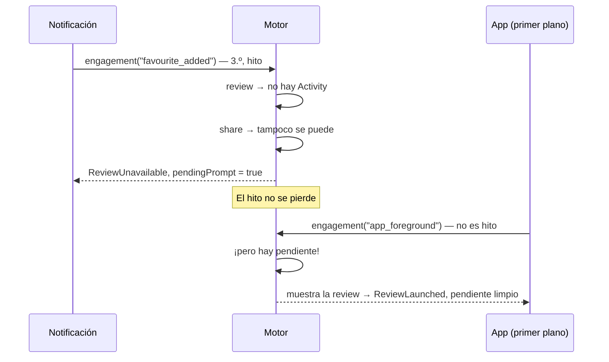
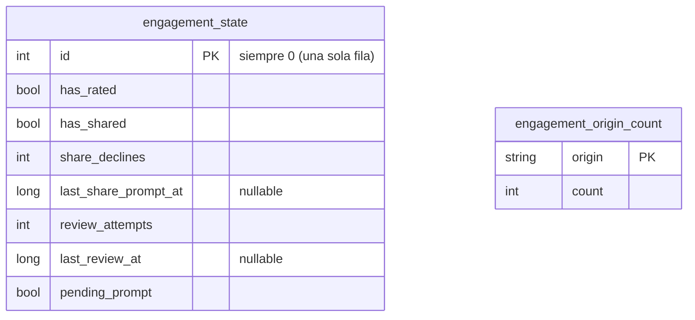
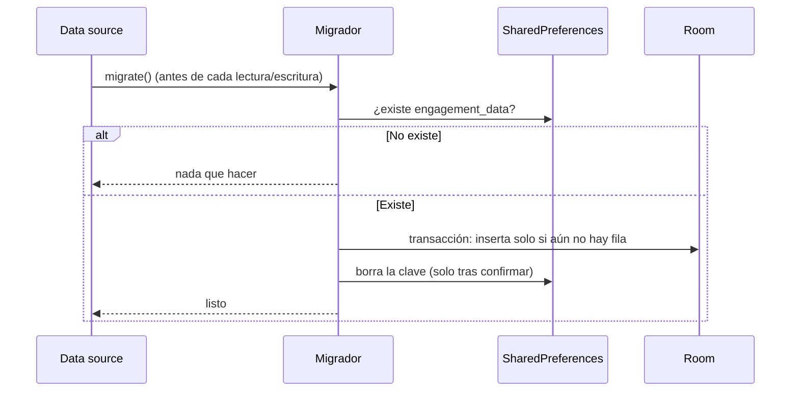

# platform-engagement

Pide al usuario **valorar la app** (in-app review de Google Play) o **compartirla** en el momento adecuado, sin agobiarle.

La app solo tiene que avisar al motor de que "ha pasado algo bueno". El motor decide si toca preguntar, qué preguntar y cuándo volver a hacerlo.

```kotlin
engagementUseCase(EngagementUseCase.Params(origin = "favourite_added"))
```

---

## 1. La idea en 30 segundos

| Concepto | Qué es | Ejemplo |
|---|---|---|
| **Origen** (`origin`) | Nombre del momento que dispara la llamada. Cada origen lleva su propio contador. | `"favourite_added"`, `"long_listening_session"` |
| **Hito** (`EngagementEligibility`) | Regla que dice en qué ocurrencia de un origen merece la pena preguntar. La define la app. | 3.ª vez, y luego cada 10 |
| **Política** (`PromptPolicy`) | Límites globales para no molestar: cuántas veces y cada cuánto se puede pedir la review o el share. | Review: 3 veces como máximo, cada 90 días |
| **Pendiente** (`pendingPrompt`) | Un hito que se alcanzó pero no se pudo mostrar. No se pierde: se muestra en la siguiente llamada. | Favorito añadido desde la notificación, con la app cerrada |

En una frase: **cada llamada suma 1 al contador de su origen. Si es un hito (o hay algo pendiente) y la política lo permite, se muestra la review o, si no se puede, el share.**

---

## 2. Qué pasa en cada llamada



Prioridad: **primero la review, después el share**. Solo se muestra una cosa por llamada.

---

## 3. Las reglas para no molestar

| | Review (in-app review) | Share («¿Compartir la app?») |
|---|---|---|
| Nunca más si… | El usuario valoró desde Ajustes (`MarkAppAsRatedUseCase`) | El usuario eligió una app para compartir |
| Máximo | 3 lanzamientos | 3 «Ahora no» |
| Espera entre dos | 90 días | 7 días |
| Separación con el otro | 7 días desde el último share | 7 días desde la última review |

La última fila hace que **como mucho se pregunte una vez por semana**, sea lo que sea.

¿Por qué la review no es "una y no más"? Google Play **no dice si el diálogo llegó a mostrarse**: tiene una cuota propia y puede ignorar la petición en silencio. Por eso se reintenta un máximo de 3 veces, separadas 90 días.

---

## 4. Casos prácticos

Los ejemplos usan la regla por defecto (`DefaultEngagementEligibility`): hito en la **3.ª** ocurrencia y luego en la **10.ª, 20.ª, 30.ª…**

### Caso 1: el camino feliz

Ana añade emisoras a favoritos.

| Favorito n.º | ¿Hito? | Qué ve Ana |
|---|---|---|
| 1, 2 | No | Nada |
| 3 | **Sí** | Diálogo de valoración de Google Play → `ReviewLaunched` |
| 4 … 9 | No | Nada |
| 10 | **Sí** | Nada: hace menos de 7 días de la review, y la siguiente review no llega hasta dentro de 90 días |
| 20 (días después) | **Sí** | «¿Compartir la app?» |

### Caso 2: la línea temporal de un usuario fiel



- Día 1: hito → review #1.
- Día 12: hito → la review está en espera, así que sale el share. Pulsa «Ahora no».
- Día 33: hito → share otra vez. «Ahora no» (lleva 2 rechazos; con el 3.º no se vuelve a preguntar).
- Día 95: hito → ya han pasado 90 días → review #2.
- Tras la review #3 no se vuelve a pedir nunca.

### Caso 3: el hito llega sin la app abierta (pendiente)

Ana marca una emisora como favorita **desde la notificación** del reproductor, con la app en segundo plano. Es su 3.er favorito, pero no hay pantalla donde mostrar la review.



La app solo necesita llamar al motor con algún origen cuando vuelve a primer plano (RadioSquare usa `"app_foreground"`, que nunca es hito por sí mismo).

### Caso 4: dos momentos a la vez

Mientras el diálogo de review está abierto, salta otro hito (por ejemplo, termina una sesión larga). El segundo **se cuenta**, pero no abre otro diálogo encima: se marca como pendiente y se ofrecerá más adelante, si las políticas lo permiten.

### Caso 5: el usuario valora desde Ajustes

En Cuenta → «Valorar la app», la app abre Play Store y llama a:

```kotlin
markAppAsRatedUseCase(MarkAppAsRatedUseCase.Params)
```

Desde ese momento **nunca** se vuelve a pedir la review a ese usuario (el share sí puede seguir).

### Caso 6: la review no se pudo lanzar y quieres ofrecer Play Store

```kotlin
engagementUseCase(EngagementUseCase.Params("alarm_dismissed")).onSuccess { result ->
    if (result == EngagementResult.ReviewUnavailable) {
        context.startActivity(intentFactory.build(IntentType.PlayStore))
        markAppAsRatedUseCase(MarkAppAsRatedUseCase.Params)
    }
}
```

Es opcional: si no haces nada, el motor ya deja el prompt pendiente cuando procede.

---

## 5. Resultados posibles

| `EngagementResult` | Significado |
|---|---|
| `None` | No se mostró nada (no era hito, las políticas no lo permiten u otro prompt estaba abierto). |
| `ReviewLaunched` | Se lanzó la review de Google Play (no garantiza que se viera). |
| `ReviewUnavailable` | No se pudo lanzar la review y no se compartió nada. |
| `ShareChosen` | El usuario compartió la app. |
| `ShareNotChosen` | Rechazó o cerró el share, o no se pudo mostrar. |

---

## 6. Dónde se guarda el progreso

En una base de datos Room propia del módulo, **`platform_engagement.db`**. La app no tiene que configurar nada.



- Cada cambio (sumar al contador, registrar una review…) se hace **en una transacción**: leer, modificar y guardar en un solo paso, así dos llamadas simultáneas nunca se pisan.
- `ObserveEngagementDataUseCase` emite los datos cada vez que cambia cualquiera de las dos tablas (útil, por ejemplo, para una tarjeta «Valora la app» en la Home).

### Usuarios que vienen de una versión anterior

Antes el progreso se guardaba como JSON en las SharedPreferences `platform_engagement`. En el primer acceso se copia solo:



- Si la app muere entre los dos pasos, la siguiente vez ve que Room ya tiene datos y solo borra la clave: **nunca se duplica ni se pierde nada**.
- Datos muy antiguos, en los que `hasRated = true` significaba "ya se lanzó la review una vez", se convierten en `reviewAttempts = 1`, `hasRated = false`.

> **Copia de seguridad:** para no perder el progreso al cambiar de móvil, la app debe incluir `platform_engagement.db` en sus reglas de Auto Backup (`data_extraction_rules.xml` y `backup_rules.xml`).

---

## 7. Integrarlo en una app

**1. Cargar las librerías** (`DeviceDILibrary` aporta `InAppReview` e `InAppShare`):

```kotlin
override fun provideLibs(): List<DILibrary> = listOf(
    DeviceDILibrary(),
    EngagementDILibrary(),
)
```

**2. Enganchar las Activities** (en `ActivityLifecycleCallbacks.onActivityCreated`):

```kotlin
inAppReview.attach(activity)
inAppShare.attach(activity) // antes de que la Activity esté STARTED
```

**3. (Opcional) Definir tus hitos y tu texto de share:**

```kotlin
class MyEligibility : EngagementEligibility {
    override fun isEligible(origin: String, count: Int): Boolean = when (origin) {
        "favourite_added" -> count == 3 || (count > 3 && count % 10 == 0)
        "long_listening_session" -> count == 1 || count == 3 || (count > 3 && count % 5 == 0)
        else -> false
    }
}

module {
    factory<EngagementEligibility> { MyEligibility() }
    factory<ShareContentProvider> { MyShareContentProvider() }
}
```

Sin ellos se usan los valores por defecto: hito en la 3.ª ocurrencia y cada 10, y un texto de share con el nombre de la app y su enlace a Play Store (strings `engagement_share_subject` / `engagement_share_text`, sobrescribibles por nombre).

**4. Llamar al motor en los momentos positivos**, con un origen distinto para cada uno.

### Consejos

- Llama al motor **después** de algo que el usuario disfrutó (terminar de escuchar, apagar una alarma que funcionó), no al abrir la app.
- Llámalo también al volver a primer plano con un origen que nunca sea hito, para que salgan los prompts pendientes.
- Llama a `MarkAppAsRatedUseCase` siempre que abras la página de Play Store para valorar.
