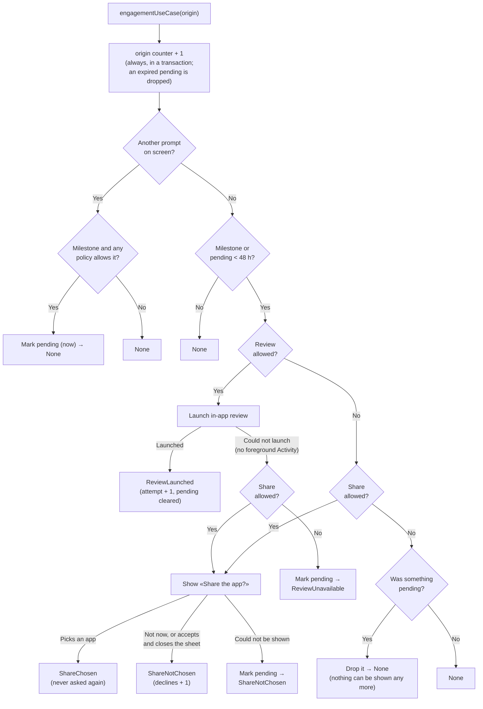
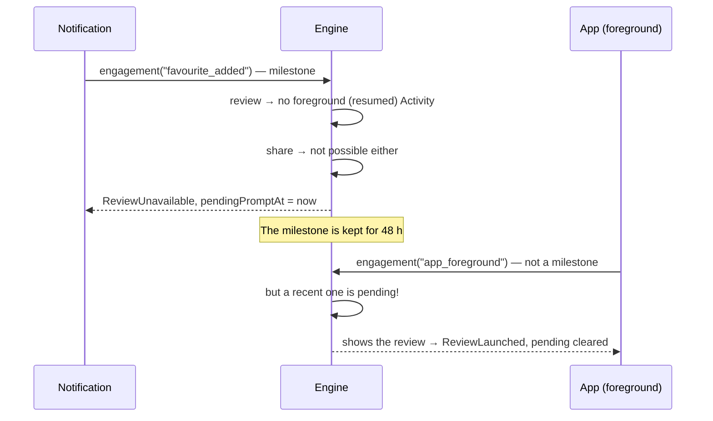
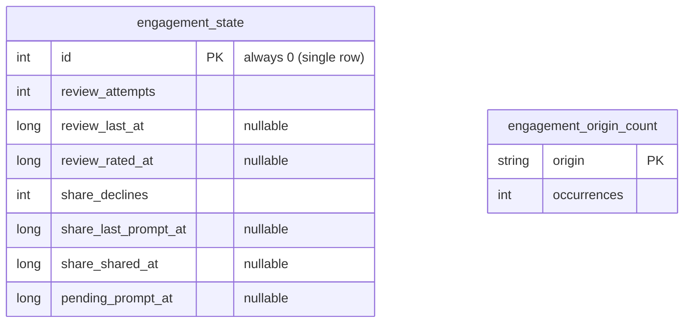

# platform-engagement

Asks the user to **rate the app** (Google Play in-app review) or **share it** at the right moment, without nagging.

The app only tells the engine that "something good just happened". The engine decides whether to ask, what to ask for and when to ask again.

```kotlin
engagementUseCase(EngagementUseCase.Params(origin = "favourite_added"))
```

---

## 1. The idea in 30 seconds

| Concept | What it is | Example |
|---|---|---|
| **Origin** (`origin`) | Name of the moment that triggers the call. Each origin has its own counter. | `"favourite_added"`, `"long_listening_session"` |
| **Milestone** (`EngagementEligibility`) | Rule that says on which occurrence of an origin it is worth asking. Defined by the app. | 3rd time, then every 10th |
| **Policy** (`EngagementPolicy`) | Global limits so the user is not bothered: how many times and how often each prompt can be shown. Overridable by the app. | Review: at most 3 times, 90 days apart |
| **Pending** (`pendingPromptAt`) | A milestone that was reached but could not be shown. It is offered on the next call, as long as it is less than 48 h old. | Favourite added from the notification while the app is closed |

In one sentence: **every call adds 1 to its origin's counter. If it is a milestone (or a recent one is pending) and the policy allows it, the review is shown or, if that is not possible, the share prompt.**

---

## 2. What happens on each call



Priority: **review first, then share**. Only one thing is shown per call.

"Allowed" always includes the install age: **nothing is shown during the first 3 days after install**. Milestones reached in that period are counted but not kept pending.

---

## 3. The rules that prevent nagging

These are the defaults of `EngagementPolicy`:

| | Review (in-app review) | Share («Share the app?») |
|---|---|---|
| Never again once… | The user rated from Settings (`MarkAppAsRatedUseCase`) | The user picked an app to share with |
| Maximum | 3 launches | 2 declines |
| Wait between two | 90 days | 30 days |
| Gap with the other one | 14 days since the last share prompt | 14 days since the last review |

| Global rule | Default |
|---|---|
| Time after install before the first prompt (`minInstallAge`) | 3 days |
| How long a pending prompt is kept (`pendingPromptTtl`) | 48 hours |

The gap row means **the user is asked at most once every two weeks**, whatever the prompt.

Why is the review not "once and done"? Google Play **does not report whether the dialog was actually shown**: it has its own quota and may silently ignore the request. That is why it is retried at most 3 times, 90 days apart.

Why does a pending prompt expire? The engine is meant to ask right after a good moment. A milestone from three weeks ago shown when the user opens the app is out of context.

A share decline is either «Not now» or accepting the prompt and then closing the share sheet without picking an app.

---

## 4. Practical cases

The examples use the default rule (`DefaultEngagementEligibility`): milestone on the **3rd** occurrence and then on the **10th, 20th, 30th…**

### Case 1: the happy path

Ana installs the app and adds stations to her favourites.

| When | Favourite # | Milestone? | What Ana sees |
|---|---|---|---|
| Day 0 | 1, 2, 3 | 3rd: **yes** | Nothing: the app was installed less than 3 days ago (not kept pending either) |
| Day 4 | 10 | **Yes** | Google Play rating dialog → `ReviewLaunched` |
| Day 10 | 20 | **Yes** | Nothing: the review was less than 14 days ago |
| Day 20 | 30 | **Yes** | «Share the app?» |

### Case 2: the timeline of a loyal user

A user who reaches a milestone almost every day:

| Day | Prompt | Why now |
|---|---|---|
| 0–2 | — | Install age below 3 days |
| 3 | Review #1 | First milestone after day 3 |
| 17 | Share → «Not now» (decline 1) | 14 days since the review |
| 47 | Share → «Not now» (decline 2) | 30 days since the last share prompt; it is never offered again |
| 93 | Review #2 | 90 days since review #1 |
| 183 | Review #3 | 90 days since review #2; it is never requested again |

5 prompts in 6 months, never two within 14 days.

### Case 3: the milestone is reached while the app is not open (pending)

Ana marks a station as favourite **from the player notification**, with the app in the background. It is a milestone, but there is no screen to show the review on.

An Activity that is still alive but in the background (behind a notification action, the lock screen, background playback) counts as no Activity: review and share only launch on a resumed Activity, so the milestone stays pending.



If Ana only comes back 3 days later, the pending prompt has expired: nothing is shown and it is dropped. Only a new milestone restarts the 48 h; calls that are eligible just because of the pending prompt do not, so it always expires.

The app only needs to call the engine with some origin when it returns to the foreground (RadioSquare uses `"app_foreground"`, which is never a milestone on its own).

### Case 4: two moments at once

While the review dialog is open, another milestone fires (for example, a long listening session ends). The second one **is counted**, but it does not open another dialog on top: it is marked as pending (restarting its 48 h) and offered later, if the policies allow it.

### Case 5: the user rates from Settings

In Account → «Rate the app», the app opens the Play Store and calls:

```kotlin
markAppAsRatedUseCase(MarkAppAsRatedUseCase.Params)
```

From then on the review is **never** requested from that user again (the share prompt can still be shown).

### Case 6: the review could not launch and you want to offer the Play Store

```kotlin
engagementUseCase(EngagementUseCase.Params("alarm_dismissed")).onSuccess { result ->
    if (result == EngagementResult.ReviewUnavailable) {
        context.startActivity(intentFactory.build(com.raxdenstudios.commons.android.intent.IntentType.PlayStore))
        markAppAsRatedUseCase(MarkAppAsRatedUseCase.Params)
    }
}
```

This is optional: if you do nothing, the engine already keeps the prompt pending when appropriate.

---

## 5. Possible results

| `EngagementResult` | Meaning |
|---|---|
| `None` | Nothing was shown (not a milestone, the policies do not allow it, or another prompt was open). |
| `ReviewLaunched` | The Google Play review was launched (it does not guarantee it was seen). |
| `ReviewUnavailable` | The review could not launch and nothing was shared. |
| `ShareChosen` | The user shared the app. |
| `ShareNotChosen` | The user declined or closed the share prompt, or it could not be shown. |

---

## 6. The data

`ObserveEngagementDataUseCase` exposes the progress as `EngagementData` (useful, for example, for a «Rate the app» card on the home screen):

```kotlin
data class EngagementData(
    val counts: Map<String, Int>,  // occurrences per origin
    val review: ReviewState,       // attempts, lastAt, ratedAt → hasRated
    val share: ShareState,         // declines, lastPromptAt, sharedAt → hasShared
    val pendingPromptAt: Long?,    // when a prompt was left pending
)
```

All times are epoch millis. `hasRated` and `hasShared` are derived from `ratedAt` and `sharedAt`, so the data also says **when** it happened.

### Where it is stored

In the module's own Room database, **`platform_engagement.db`**. The app does not need to configure anything.



- Every change (incrementing a counter, recording a review…) runs **in a transaction**: read, modify and save in one step, so two simultaneous calls never overwrite each other.
- **Only what changed is written**: a call that only increments a counter updates that one row and leaves the state row untouched. A call that changes nothing writes nothing.

Progress stored by versions before the Room database (JSON in the `platform_engagement` SharedPreferences) is **not** carried over: every user starts from zero.

> **Backup:** to keep progress when the user switches phones, the app must include `platform_engagement.db` in its Auto Backup rules (`data_extraction_rules.xml` and `backup_rules.xml`).

---

## 7. Integrating it into an app

**1. Load the libraries** (`DeviceDILibrary` provides `InAppReview` and `InAppShare`):

```kotlin
override fun provideLibs(): List<DILibrary> = listOf(
    DeviceDILibrary(),
    EngagementDILibrary(),
)
```

**2. Attach the Activities.** The prompts need the running Activity, attached before it is STARTED. The easiest way is to enable `EngagementPromptsInitializer` from `platform-device` in the app's androidx.startup provider; it attaches `InAppReview` and `InAppShare` to every created `ComponentActivity`:

```xml
<provider
    android:name="androidx.startup.InitializationProvider"
    android:authorities="${applicationId}.androidx-startup"
    android:exported="false"
    tools:node="merge">
    <meta-data
        android:name="com.raxdenstudios.platform.device.initializer.EngagementPromptsInitializer"
        android:value="androidx.startup" />
</provider>
```

Koin must be started (with `DeviceDILibrary`) by the app's own initializer or `Application.onCreate`; the initializer resolves its dependencies when the first Activity is created. To keep the prompts off some screens (a full-screen alarm over the lock screen, for example), bind a filter; a milestone reached while such a screen is in front stays pending:

```kotlin
module {
    single { EngagementPromptsActivityFilter { activity -> activity !is AlarmRingingActivity } }
}
```

Without the initializer, attach them yourself in `ActivityLifecycleCallbacks.onActivityCreated`:

```kotlin
inAppReview.attach(activity)
inAppShare.attach(activity) // before the Activity is STARTED
```

Details in the [platform-device README](../device/README.md#activity-initializers).

**3. (Optional) Define your own milestones and share copy:**

```kotlin
class MyEligibility : EngagementEligibility {
    override fun isEligible(origin: String, count: Int): Boolean = when (origin) {
        "favourite_added" -> count == 3 || (count > 3 && count % 10 == 0)
        "long_listening_session" -> count == 1 || count == 3 || (count > 3 && count % 5 == 0)
        else -> false
    }
}

module {
    factory<EngagementEligibility> { MyEligibility() }
    factory<ShareContentProvider> { MyShareContentProvider() }
}
```

Without them the defaults apply: a milestone on the 3rd occurrence and every 10th, and a share message with the app name and its Play Store link (strings `engagement_share_subject` / `engagement_share_text`, overridable by resource name).

**4. (Optional) Change the rate limits** by overriding `EngagementPolicy` from a module loaded after `EngagementDILibrary`, for example from Remote Config:

```kotlin
module {
    factory {
        EngagementPolicy(
            shareCooldown = remoteConfig.getLong("share_cooldown_days").days,
            minInstallAge = 7.days,
        )
    }
}
```

Set `maxReviewAttempts` or `maxShareDeclines` to `0` to turn that prompt off. The policy is read once, when `EngagementUseCase` is first created.

**5. Call the engine at positive moments**, with a different origin for each one.

### Tips

- Call the engine **after** something the user enjoyed (finishing a listening session, dismissing an alarm that worked), not when the app opens.
- Also call it when returning to the foreground with an origin that is never a milestone, so pending prompts get shown.
- Call `MarkAppAsRatedUseCase` whenever you open the Play Store page to rate.
